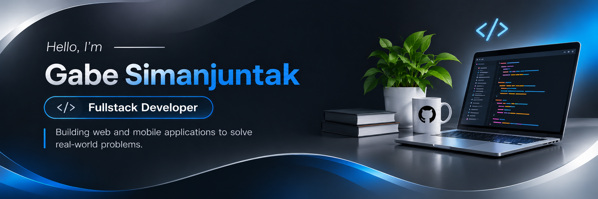

### I'm a Fullstack Developer

I build web and mobile applications with Laravel, PHP, and Flutter, with a focus on solving practical problems.

---

## 👾 Pac-Man Contribution Graph

<picture>
  <source media="(prefers-color-scheme: dark)"
    srcset="https://raw.githubusercontent.com/GabeSimanjuntak/GabeSimanjuntak/output/pacman-contribution-graph-dark.svg">
  <source media="(prefers-color-scheme: light)"
    srcset="https://raw.githubusercontent.com/GabeSimanjuntak/GabeSimanjuntak/output/pacman-contribution-graph.svg">
  
</picture>

---

## 📊 GitHub Analytics

---

## ⚡ Skills & Abilities

### Core Tech Stacks

### Other Tech Stacks

### Tools

---

### CONNECT

*ESTABLISHING UPLINK — GABE SIMANJUNTAK*

 

  

**"Code. Create. Innovate. Repeat."**

