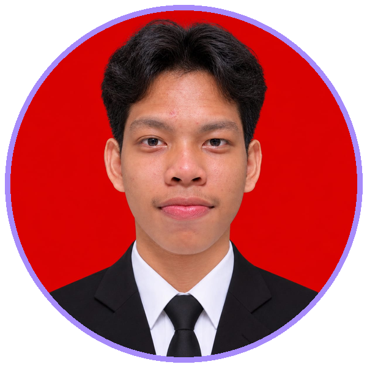

 

# Gabe Simanjuntak

### Fullstack Developer | Mobile Developer

*Building digital experiences, one line of code at a time.*

---

## 👨‍💻 About Me

Hello! I'm **Gabe Simanjuntak**, a Fullstack Developer passionate about building modern applications and solving real-world problems through technology.

- 💻 Focused on Fullstack & Mobile Development
- ⚙️ Backend development with Laravel and PHP
- 📱 Cross-platform application development with Flutter
- 🌐 Exploring modern web technologies
- 🧠 Interested in Artificial Intelligence & Machine Learning
- 🎯 Always learning, building, and improving.

---

## ⚡ Tech Stack

### Programming Languages

### Frameworks & Libraries

### Database & Infrastructure

### Tools & Design

---

## 🚀 Featured Projects

<table>
<tr>
<td width="50%" valign="top">

### ♻️ Bank Sampah Tarhilala

Waste management application connecting customers with waste collection and savings services.

**Tech Stack**
- Laravel API
- Flutter
- MySQL

</td>
<td width="50%" valign="top">

### 📚 Gairmos Library

A digital library application for managing book borrowing and returning processes.

**Tech Stack**
- Flutter
- Laravel
- MySQL

[View Repository ↗](https://github.com/GabeSimanjuntak/aplikasi_peminjaman_buku)

</td>
</tr>
<tr>
<td width="50%" valign="top">

### 🏡 Sistem Informasi Desa Taonmarisi

A web-based village information system designed to improve access to local information.

**Focus**
- Web Development
- Information Systems

</td>
<td width="50%" valign="top">

### 🧭 SmartRoute

A transportation application concept focused on solving local mobility challenges.

**Focus**
- UI/UX Design
- Figma
- Digital Innovation

</td>
</tr>
</table>

---

## 📊 GitHub Analytics

---

## 👾 Pac-Man Contribution Graph

<picture>
  <source media="(prefers-color-scheme: dark)"
    srcset="https://raw.githubusercontent.com/GabeSimanjuntak/GabeSimanjuntak/output/pacman-contribution-graph-dark.svg">
  <source media="(prefers-color-scheme: light)"
    srcset="https://raw.githubusercontent.com/GabeSimanjuntak/GabeSimanjuntak/output/pacman-contribution-graph.svg">
  
</picture>

---

## 🏆 GitHub Trophies

---

## 📈 Contribution Activity

---

## 🤝 Let's Connect

 

  

**"Code. Create. Innovate. Repeat."**

